# Network: how traffic enters and leaves a cell

How every kind of transfer reaches a Glovecell sandbox and leaves it. That
covers agent sessions, files, repositories, web, model providers, MCP, A2A,
ACP, previews, LAN devices and telemetry. Decision
[D14](decisions.md#d14--one-gateway-per-cell-2026-10-30) makes the cell
gateway the only way in and out. An interactive version of this page is in
[network.html](network.html): open it in a browser and pick a channel.

Marks used below: **(design)** is already in [glovecell.md](glovecell.md),
**(D12/D13)** comes from those decisions, and **(proposed)** is new here and
not built yet.

## Now / Change / Why this way / Risk and undo / Words

- **Now**:
  - Traffic leaves a cell through its egress proxy (design, section 4).
  - Some inbound paths are described separately: previews and dev links
    through the gateway route (4.7), the Orca pairing listener (9), and file
    uploads through the console.
  - MCP, A2A and ACP are not described at all.
- **Change**: one **cell gateway** per cell handles both directions:
  - an **egress side**, which is today's inspecting proxy;
  - an **ingress side**, a reverse-proxy listener in the same pod.

  Every transfer type is a named **channel**, with one route, one
  authentication rule, one policy check and one audit record.
- **Why this way**:
  - One place per cell to enforce, audit and explain traffic.
  - The sandbox pod accepts connections only from its own gateway, and can
    reach only its own gateway (plus timed LAN grants).
  - Adding a protocol means adding a channel, not a new hole.
- **Risk and undo**:
  - The gateway becomes a single point of failure for the cell. It fails
    closed, so a broken gateway stops traffic and never opens it.
  - Ingress is additive: until it is built, today's separate inbound paths
    keep working.
- **Words**:
  - **Edge**: the cluster's shared entry point (Gateway API or ingress
    controller) where people and outside agents sign in.
  - **Channel**: one kind of transfer (for example "MCP, remote").
  - **Placeholder**: a fake credential the agent holds; the gateway swaps in
    the real one on reviewed routes.
  - **Cell CA**: the per-cell certificate authority the gateway uses to
    inspect HTTPS.

## 1. Overview

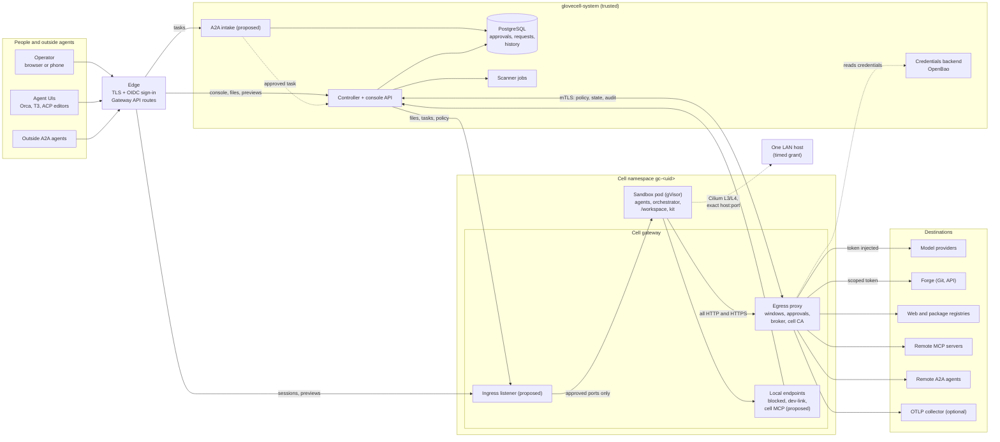

The sandbox pod has exactly three network neighbours:
- its own gateway, in both directions;
- DNS, which only answers for the gateway;
- a LAN host, while a grant is open.

The gateway holds no Kubernetes credentials. It talks to the controller over
mTLS.

## 2. Enforcement layers

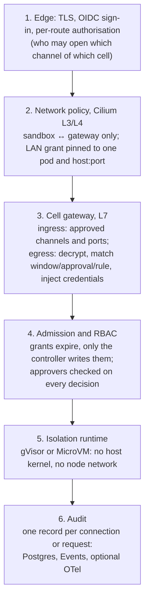

A request has to pass every layer that applies to it. Each layer fails
closed on its own.

## 3. Channels

| Channel | Direction | Path | Protocol | Who authenticates | Locked | Ask | Standard | Open (timed) | Audit |
|---|---|---|---|---|---|---|---|---|---|
| Agent session (Orca, T3) | in | edge → gateway ingress → orchestrator port | HTTPS, WebSocket | operator OIDC plus pairing | ✓ | ✓ | ✓ | ✓ | open/close, bytes |
| Agent session (ACP) **(proposed)** | in | edge → ingress → ACP bridge → agent stdio | JSON-RPC over WebSocket | operator OIDC | ✓ | ✓ | ✓ | ✓ | session, prompts by count |
| Model providers | out | sandbox → egress → provider | HTTPS, SSE, WebSocket (D13) | broker injects token | ✓ | ✓ | ✓ | ✓ | per request |
| Repository (own) | out | sandbox → egress → forge | Git smart HTTP, API | scoped forge token | ✓ | ✓ | ✓ | ✓ | per request |
| Web | out | sandbox → egress → host | HTTPS | none, or a named profile | rules and approvals only | new requests wait for approval | plus common hosts | all public hosts | per request |
| Packages | out | sandbox → egress → registry | HTTPS | registry profile | approved versions | ask per version | plus registries | all | per request |
| Files in | in | operator → console → controller → ingress → `/workspace/inbox` | HTTPS stream | operator OIDC | ✓ operator action | ✓ | ✓ | ✓ | name, size, hash |
| Files out | out | sandbox outbox → scan → console download | HTTPS stream | operator OIDC | ✓ after scan | ✓ | ✓ | ✓ | name, size, hash, findings |
| Previews and dev links | in | edge → ingress → app port | HTTPS, WebSocket | operator OIDC plus verification card | ✓ after scan and approval | ✓ | ✓ | ✓ | per request |
| MCP, local (stdio) | none | inside the sandbox | stdio | — | ✓ | ✓ | ✓ | ✓ | the agent's own telemetry |
| MCP, cell tools **(proposed)** | local | sandbox → gateway local endpoint | MCP over HTTP | per-pod token | ✓ | ✓ | ✓ | ✓ | per call |
| MCP, remote | out | sandbox → egress → MCP server | streamable HTTP, SSE | broker injects the server's token | approved hosts | ask | named servers | all public | per request |
| A2A, inbound task **(proposed)** | in | outside agent → edge → A2A intake → approval → cell | JSON-RPC over HTTPS, SSE | OAuth2 client or mTLS | queued for approval | queued | queued | queued | task, decision |
| A2A, outbound | out | sandbox → egress → remote agent | JSON-RPC over HTTPS, SSE | named profile | approved hosts | ask | named agents | all public | per request |
| LAN device | out | sandbox → host:port (not via the gateway) | TCP | — | timed grant only | timed grant | timed grant | timed grant | flow logs, grant history |
| Telemetry | out | sandbox → egress telemetry route → collector | OTLP/HTTP | collector token | ✓ | ✓ | ✓ | ✓ | counts only |
| Vendor telemetry | out | — | — | — | refused | refused | refused | refused | denial |

Notes:
- **Inbound is the same at every level.** The level controls what the cell may
  reach, not who may reach the cell. Inbound always needs the operator (or an
  approved task).
- **Open is time-limited** (at most 8h; D12 grant rules). Private, cluster and
  metadata addresses are refused at every level; LAN goes through grants only.
- **"Ask"** holds a new request as pending in PostgreSQL (D13). The operator
  approves it once (exact match) or promotes it to a rule.

## 4. Egress decision

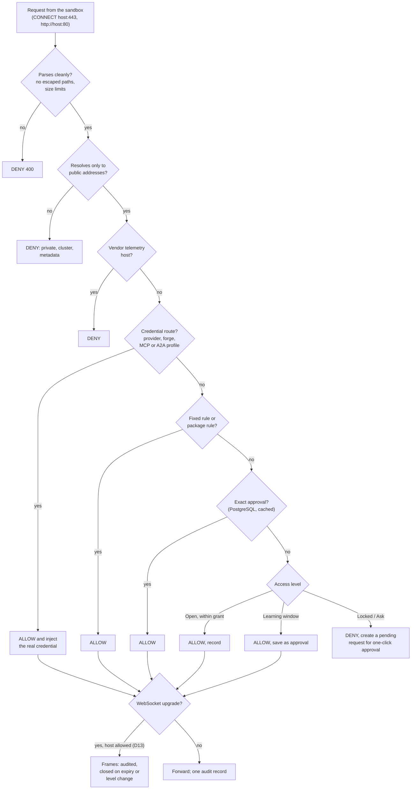

Every branch writes one audit record. If the audit outbox is full,
everything except credential routes is denied (design 4.1).

## 5. Sequences

### 5.1 Agent session (Orca or T3; ACP the same way)

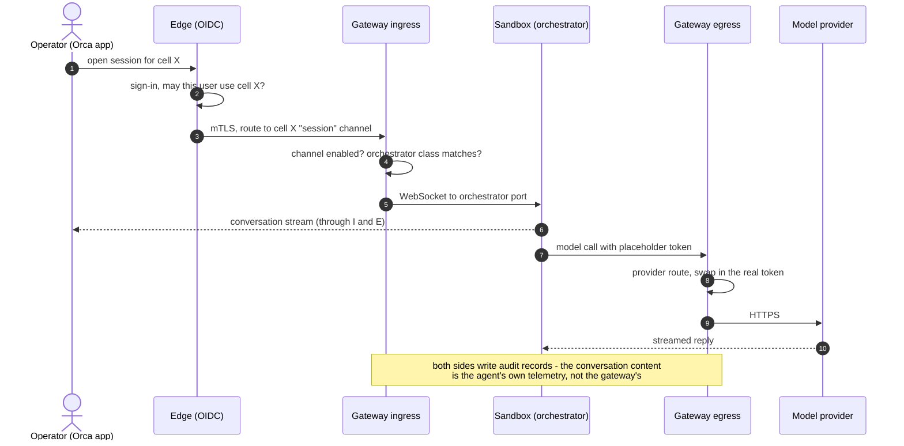

### 5.2 Web request that needs approval

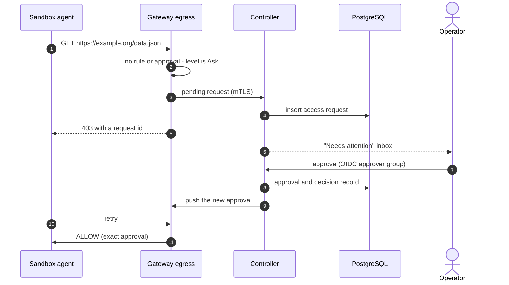

### 5.3 Repositories

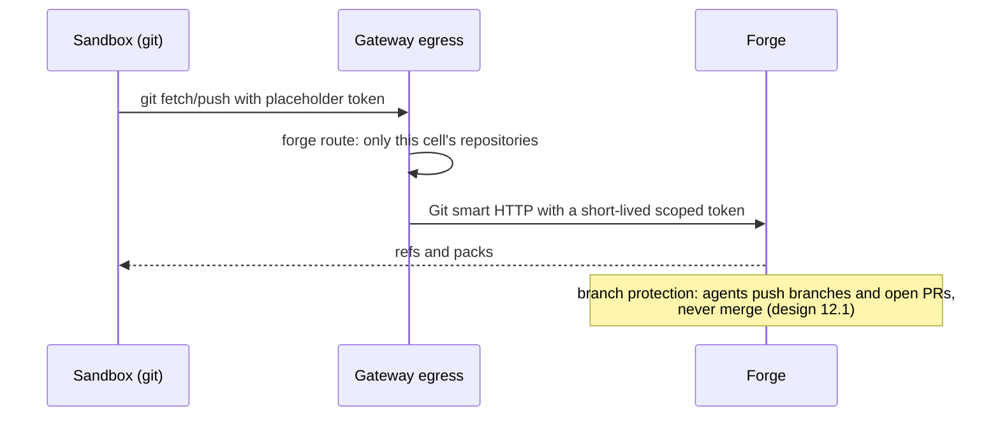

### 5.4 Files in and out

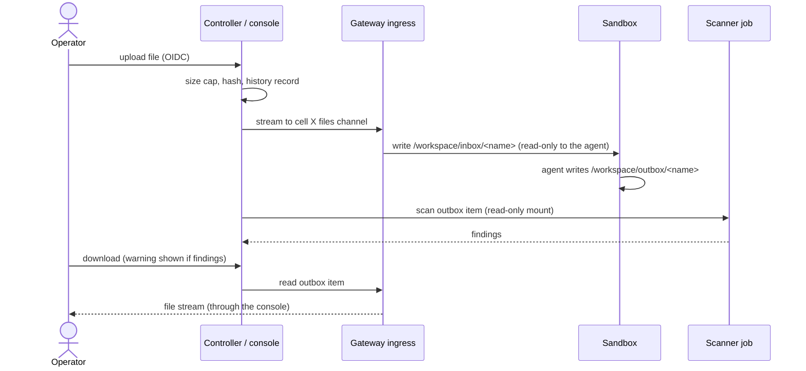

### 5.5 MCP

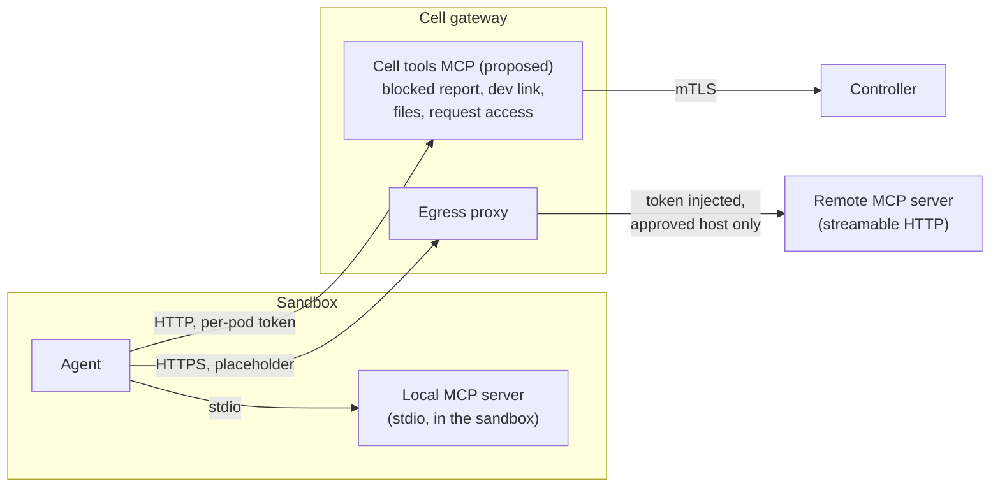

- MCP server configuration ships in the agent kit (D6), so every orchestrator
  gets the same tools.
- Cell tools replace orca-pilot's CLI commands, so any UI can use them.
- A local server's own network calls go through the egress proxy like any
  other request.

### 5.6 A2A

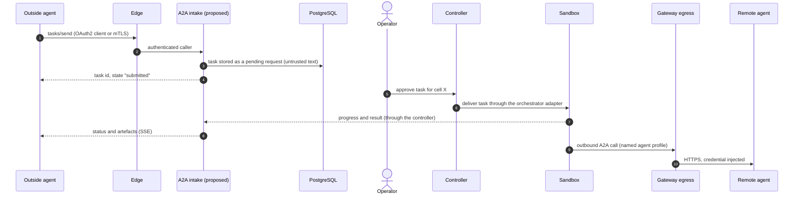

Inbound tasks never connect straight to a cell. They become pending requests
that the operator approves, like web requests. Their text is treated as
untrusted input that may carry prompt injection.

### 5.7 Previews and dev links

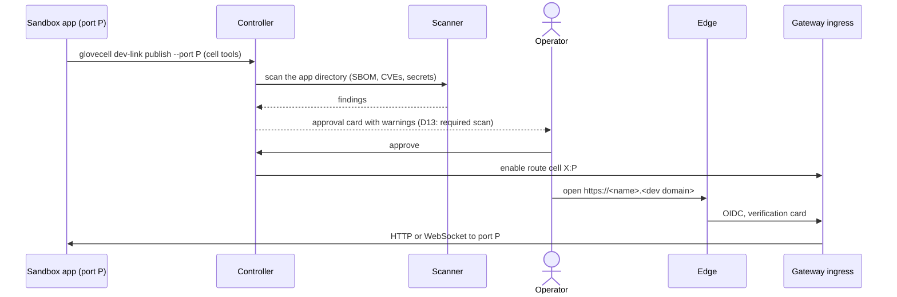

### 5.8 LAN device

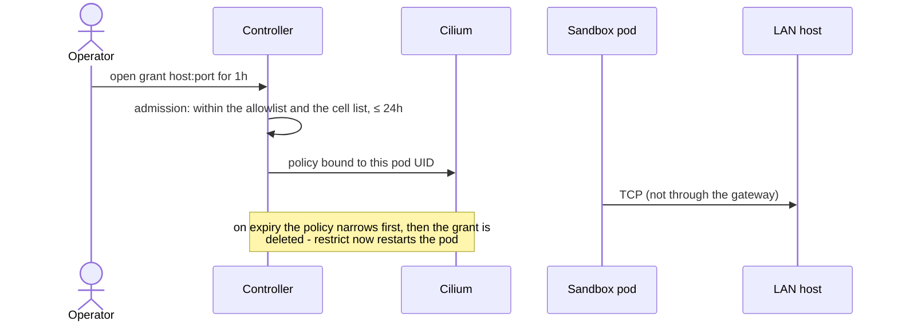

## 6. What the gateway refuses

- **Raw TCP or UDP to the internet.** Use HTTPS, or a LAN grant for local
  devices.
- **Certificate-pinned clients:** they fail against the cell CA, and there is
  no blind passthrough (D13).
- **Private, cluster, node and metadata addresses** at every level.
- **Inbound connections that don't come through the edge,** and ports that
  are not approved.
- **Credentials sent inside WebSocket frames:** only header credentials can be
  brokered (D13).
- **Vendor telemetry** from UIs and agents.

## 7. Building order (proposed)

1. **Ingress listener in the gateway pod.** Move the preview, dev-link and
   session routes onto it, and tighten the sandbox network policy to "from
   the gateway only".
2. **Cell tools MCP endpoint**, with orca-pilot's commands moved onto it.
3. **WebSocket support in the egress proxy** (D13 item 3).
4. **Files channel** through the ingress.
5. **ACP bridge** and the `acp` orchestrator class.
6. **A2A intake.**
