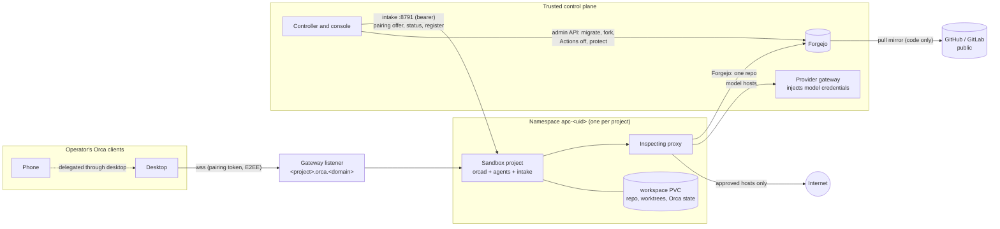

# Design: an Orca runtime per project sandbox, and public repository import

Status: proposal, 2026-10-23. Nothing here is implemented. Deployment-specific
details (host names, listeners, measured capacity, infrastructure file paths)
are in the operator's infrastructure repository, in the companion note
[project Orca runtimes](https://git.cluster.aimingupward.com/steve/opnsense-kubernetes-bgp/src/branch/task/orca-pilot/project-orca-design/infra/agent-workplace/docs/project-orca-runtimes.md),
so this document stays deployment-neutral like the rest of `docs/`.

## Goal

1. **New sandbox** in the console produces a project sandbox that runs its own
   Orca runtime. The runtime is paired to the operator's Orca clients (desktop
   and phone), the project appears in Orca without manual registration,
   worktrees live inside that sandbox, and each project is its own Orca trust
   boundary.
2. The operator can paste a public GitHub or GitLab project URL. The controller
   imports it into Forgejo and then continues with (1).

## Current state

**Project sandboxes.** **New sandbox** creates a `ProjectWorkspace`. The
controller grants a repository-scoped Forgejo bot identity, creates namespace
`apc-<uid>` (restricted Pod Security), a per-project inspecting egress proxy,
CiliumNetworkPolicies that let the worker reach only DNS and that proxy, a
`workspace` PVC and an Agent Sandbox `Sandbox` named `project`. The worker
clones the repository, switches to `agent/apc-<uid>` and reports Ready. The
worker runs `sleep`; work arrives through `kubectl exec` or T3. It is not an
Orca runtime and nothing is paired to it. See [security](../security.md),
[API](../api.md) and `internal/controller/reconciler.go`.

**Orca projects.** The console's **Orca projects** page relays
`POST /api/v1/orca-projects` to the handoff intake of one shared Orca runtime
(`internal/web/handoffs.go`). The intake clones the repository with the
runtime's own Forgejo access and registers it with Orca. Every client paired
with that runtime gets full use of every project, and all projects share the
runtime's credentials, cluster access and network policy. The console already
warns: "Use a separate runtime and pairing when projects need separate trust
boundaries." This design builds that separate runtime.

**How the shared runtime is built.** One Agent Sandbox `Sandbox` with a single
container running `orca-pilot serve`. That process starts `orcad` (port 6768,
`--pairing-address <public wss address>`), a run-record publisher (8790) and a
bearer-authenticated handoff intake (8791). Agents (Claude Code, Codex and
others) are child processes of `orcad` in the same container. Orca state
(device registry, end-to-end encryption key pair, session journal) is in
`ORCA_USER_DATA_PATH`; worktrees are under `~/orca/workspaces`. The renderer,
image, CI and promotion flow live in the infrastructure repository and assume
exactly one runtime (fixed namespace, host name, volumes, node and
cross-namespace object names).

**Things the controller already has that this design reuses:**

- a per-sandbox runtime plug-in slot, `ProjectAccess` (`Ensure`, `Suspend`,
  `Remove`), used today by T3 Connect with a durable intent ledger;
- a fail-closed `apply()` that refuses drift on running sandboxes;
- removal that verifies external revocation and PersistentVolume cleanup before
  it reports `Removed`;
- an inspecting proxy with per-project CA, exact host, method and path rules,
  and brokered provider routes through a trusted gateway;
- an administrator Forgejo token held only by the controller.

**Gaps found while checking.**

- `protect()` refuses Forgejo mirror repositories and any repository whose
  default branch is not `main` (`internal/forgejo/client.go`). Many public
  repositories use `master` or another default.
- HTTPS rules change only while the sandbox is paused. That ends every Orca
  agent session whenever a host has to be added.
- There is no Claude credential path for project sandboxes; provider grants
  cover Codex, Grok, Cursor and Muse.
- Adding a container, mount or environment variable to the `project` pod
  template is drift for every running sandbox, and `apply()` fails closed.

## Target architecture

A `ProjectWorkspace` gains one immutable field, `spec.runtime`, with values
`none` (today's behaviour, the default) and `orca`. An Orca project sandbox is
today's project sandbox plus:

- the Orca runtime image as the single worker container, running the runtime's
  `serve` entrypoint instead of `sleep`;
- Orca state and worktrees on the existing `workspace` volume;
- a headless Service and a Gateway API `HTTPRoute` for the runtime's WebSocket
  port on a dedicated listener;
- an ingress rule from the controller to the intake port and from the gateway
  to the runtime port;
- an egress rule to the telemetry collector;
- a pairing state machine in status and in a durable ledger, as T3 Connect has
  today.

A new `RepositoryImport` resource drives the import. When it reaches `Ready`,
the console creates the `ProjectWorkspace` for the imported working repository.

## Decisions

Each section gives the recommendation first, then the alternatives that were
considered.

### 1. Runtime shape

**Recommendation: run `orcad` as the one worker container of the project
Sandbox**, using the Orca runtime image (today's `orca-pilot` image) in a
project mode, not as a sidecar next to the current workspace container.

- Orca starts agents as child processes, in its own process tree, with its own
  PATH, home and working directories. The agents must see the repository, the
  toolchains and the provider wrappers. With a sidecar, agents would run in the
  sidecar anyway and the workspace container would sit idle.
- One container keeps the security context that `safePod()` already enforces:
  non-root, read-only root, all capabilities dropped, gVisor, no service
  account token.
- The Orca image is already built on a coding base image with the same
  toolchains as the workspace image, and it already contains the provider
  wrappers and native OpenTelemetry wiring. Extending the workspace image with
  Orca would fork the Orca build and its promotion flow.

The controller keeps the pod spec; the image keeps the process model (see 2).

**Per-project cost.** The shared runtime requests 250m CPU and 512Mi and is
limited to 4 CPU and 4Gi. Measured over the seven days before 2026-10-23, it
used 40–70m CPU and 0.4–0.8 GiB while idle. With agents running, p95 reached
about 1.6 CPU and 2.2 GiB, with peaks at the 4-CPU limit and about 4.4 GiB
working set. That runtime hosts several projects, so one project runtime is
usually smaller. Add about 100m and 128Mi for the per-project proxy and the
gVisor pod overhead.

**Recommended defaults:**

- runtime request: 250m CPU and 1Gi; limit: 4 CPU and 4Gi. The memory request
  is raised from 512Mi so the scheduler sees the idle footprint;
- volume: 20Gi for Orca projects, against the 10Gi default. Worktrees and
  Orca's journal grow;
- a controller setting `MAX_RUNNING_ORCA_RUNTIMES`, default 8. **New
  sandbox** and **Resume** fail with a clear message above it. A paused runtime
  costs only disk.

On the reference cluster, memory on the gVisor nodes is the binding limit. The
companion note has the arithmetic: about four to six runtimes with active
agents at the same time plus a few idle ones. That is why the default cap is 8.

**Alternatives.** A sidecar next to the workspace container was rejected for
the reasons above. Orca's own per-workspace environment recipes (an
`environmentRecipes` entry in `orca.yaml` whose `create` script returns a
`pairingCode`) were considered. Recipes make the operator's desktop own the
life cycle of one disposable environment per Orca workspace. They need
`orca.yaml` on each repository's primary branch and run lifecycle scripts on
the desktop. They do not give a durable project sandbox that the console owns,
so they are left as a later option.

### 2. Reuse of the existing renderer: one source of truth

**Recommendation: the image owns the runtime contract; the controller owns the
Kubernetes objects.**

- The runtime image's `serve` entrypoint reads everything that differs between
  runtimes from environment variables:
  - public address;
  - pairing scope;
  - user-data path;
  - home and worktree root;
  - intake address and token file;
  - run-record host;
  - OTel resource attributes;
  - optional Gitea provider base URL and token file.
- Integrations that only make sense for the operator's personal runtime
  (cluster reader token, Grafana MCP, sandbox-control broker, kubeconfig) turn
  on only when their mounts are present. Project mode mounts none of them.
- The image publishes its contract version as an OCI label, for example
  `dev.orca.runtime-contract=1`. The controller refuses an image whose contract
  version it does not support. That is fail closed.
- The controller builds the per-project objects in Go, as it does for every
  other project object. Deployment-specific values come from controller
  configuration, not from the image or the infrastructure repository:
  - the image digest;
  - gateway listener names and domain;
  - collector endpoint;
  - extra `NO_PROXY` hosts.
- The infrastructure repository keeps building, scanning and promoting the
  image. Its promotion writes the new digest into the controller's
  configuration (`ORCA_RUNTIME_IMAGE`) as well as into the shared runtime's
  render.

**Alternatives.**

- Importing `orca-pilot render` as a Go library: it is private infrastructure
  source with deployment constants, which `AGENTS.md` forbids in reusable code.
- A pod template stored in the infrastructure repository and read by the
  controller at run time: this splits validation from construction, makes
  `apply()` drift checks depend on an external file, and still needs per-project
  substitution.

### 3. Network

**Address: one host name per project, `<project>.orca.<domain>`**, served by
an `HTTPRoute` in the project namespace on a dedicated gateway listener with a
wildcard certificate for `*.orca.<domain>`.

- The listener accepts routes only from namespaces carrying a controller-set
  label. An admission policy allows that label only on `apc-*` namespaces the
  controller created, and allows routes there only with the host name derived
  from the `ProjectWorkspace` name.
- The project name already fits one DNS label (`^[a-z][a-z0-9-]{0,39}$`).
- A private (tailnet) listener on the same wildcard gives off-LAN access the
  same way. The operator's DNS needs one suffix rule, not one entry per
  project.
- A wildcard certificate keeps project names out of Certificate Transparency
  logs.

**TLS.** TLS terminates at the gateway, and the backend hop is plain WebSocket
to the runtime's headless Service, as for the shared runtime today. Orca's own
pairing token and end-to-end encryption key pair remain the access control.
Exposure is LAN and private network only, never the public internet.

**Alternatives.**

- Flat names such as `orca-<project>.<domain>` on the existing `*.<domain>`
  listener need no new certificate. However, that listener accepts routes from
  every namespace, and a typo can collide with other application names.
- One Orca router routing by host to every runtime adds a component that sees
  every session's handshake and must be kept highly available. Orca traffic is
  end-to-end encrypted (unverified in detail), so it would gain nothing.

**One egress authority: the per-project proxy.**

- Orca needs model provider hosts, package registries (npm, PyPI, Go) and the
  in-cluster Forgejo API for its Gitea provider. Its OpenTelemetry export goes
  directly to the collector by Cilium rule, not through the proxy.
- Recommendation: everything goes through the controller's per-project
  inspecting proxy. Model credentials are injected by the trusted provider
  gateway (see 5). The operator's sandbox-control egress proxy is not used for
  project sandboxes.

Why the project proxy:

- The controller already creates and deletes it, its CA and its Cilium policies
  with the sandbox. Removal can verify all of it.
- sandbox-control's workspace catalog is a static file that is read at
  start-up. It identifies a workspace by one pod's IP and is edited from the
  operator desktop. Each catalog change restarts sandbox-control and resets
  every preview approval. It cannot follow sandboxes that come and go through
  the console.
- Two authorities for one sandbox would make "fail closed" ambiguous: which
  denial wins, and which audit trail is complete.

Two changes make the project proxy workable for long-running agents:

1. **Additions while running.**
   - An operator approval in the console may add an exact host, method and
     path rule to a running sandbox. The proxy reloads its policy ConfigMap
     without a restart. The approval is recorded in the audit trail like a
     paused edit.
   - Removals still require Pause, because removing a grant must also end
     connections that already use it.
   - This changes a documented security rule, so it is a decision for the
     operator.
2. **Blocked reports to the controller.** The runtime image's
   `blocked report` command posts to the project proxy's local report endpoint,
   authenticated by the per-project proxy token. The proxy forwards to the
   controller. The console shows open reports per sandbox. This replaces the
   sandbox-control broker for project sandboxes.

Default rules for an Orca project:

- the Forgejo repository rules;
- the brokered model hosts;
- read-only (`GET`) access to the registries the operator ticks.

Imported repositories start with no registries until the operator adds them
(see 10).

### 4. Pairing

**How Orca pairing works (checked against the bundled runtime, 1.4.23x).**

- On start, `orcad --pairing-address <wss address>` creates one pending device
  in its device registry and prints a pairing offer (`orca://pair?...`) that
  carries that device's bearer token, the address and the runtime's public key.
  The offer is a credential: whoever presents it first becomes a paired device
  with full control of the runtime.
- Scope `runtime` (desktop and CLI, `orca environment add`) and scope `mobile`
  (phone QR) are separate offers.
- A runtime-scope device can sync delegated phones
  (`pairing.delegatedMobileDevice.sync`): phones paired to the desktop are
  relayed as "<phone> via <desktop>".
- Server-side revocation exists inside `orcad`:
  - `revokeRuntimeAccess(deviceId)` removes a desktop device and every phone
    delegated through it.
  - `revokeMobileDevice` removes one phone.
  - Neither is exposed through the headless CLI or a documented RPC in this
    build (unverified).
- The device registry (`orca-devices.json`) and key pair
  (`orca-e2ee-keypair.json`) live in the runtime's user-data directory.

**Recommendation: pair the desktop automatically through a narrow console API;
phones follow through desktop delegation; the console's pairing card is the
fallback.**

1. When the runtime is Ready, the controller reads the current offer from the
   runtime's intake (`GET /pairing`, bearer-authenticated, reachable only from
   the controller). The offer is never written to a Secret, a status field,
   logs or audit records. Status records only `Pairing: Offered`, `Claimed` or
   `Revoked`, with device counts.
2. A small helper on the operator's desktop polls `GET /api/v1/pairings` with a
   dedicated bearer scoped to pairing routes only (`PAIRING_CLIENT_SECRET`).
   - For each offered runtime, it calls `POST /api/v1/pairings/<name>/claim`.
     That call returns the offer once.
   - The helper then runs
     `orca environment add --name <project> --pairing-code <offer>` without
     echoing the offer, and reports success.
   - The controller confirms the claim by asking the intake for the device
     count.
   - The helper can be an Orca automation on the desktop or a user-level timer.
   - A desktop Orca window rereads saved servers only at start-up or when
     **Settings → Remote Orca Servers** opens, so the helper notifies the
     operator to open it.
3. Phones reach project runtimes through desktop delegation. Whether a phone
   sees a newly paired runtime without its own pairing is unverified; spike B0
   answers it. If it does not, the fallback applies to phones.
4. **Fallback:** the sandbox page shows a **Pair a device** card, for an
   OIDC-authenticated operator session only. It has a QR code and a copy
   button, plus the `orca environment add` command. The offer is fetched on
   click and never cached by the console.

**Where pairing secrets live.** Only in the runtime's user-data directory on the
project volume, and in the clients' own pairing stores. Kubernetes holds none.
The intake bearer that lets the controller read offers is a per-project random
value in the controller's ledger Secret and in a Secret in the project
namespace, like the Git identity.

**Unpair and revoke.**

- **Remove:** deleting the namespace and verifying the PersistentVolume is gone
  destroys the device registry and key pair, so every pairing is dead
  server-side. The desktop helper then runs `orca environment rm` for removed
  projects. Client clean-up is reported, not awaited: a saved environment
  without its server grants nothing.
- **Pause:**
  - The pod stops, so no client can connect while paused.
  - On **Resume**, the runtime starts with a fresh pairing identity (empty
    device registry, new key pair), and the helper pairs again automatically.
    The controller does this through a pairing generation in the ledger. The
    runtime entrypoint clears its pairing state at start when the generation
    differs, and only while `orcad` is not running.
  - This needs either an upstream headless revoke or confirmation that clearing
    the registry while `orcad` is stopped is safe. Spike B0 checks it. The
    infrastructure runbook advises against editing the registry file of a
    running runtime.
  - Until that is confirmed, Pause only stops the pod, and the console says
    "pairings survive Pause".
- **Revoke one device** (lost phone): needs an upstream headless revoke. Until
  then, the console offers **Reset pairings**. It pauses the sandbox, bumps the
  pairing generation and resumes it, which revokes every device on that
  runtime.

**Alternatives.**

- Typing or scanning a code per device per project: this is the fallback, but
  it is the toil the operator wants removed.
- Pushing offers to the desktop over the existing shared runtime: the pairing
  store is on the client, not on any runtime, so a runtime cannot pair a client
  to another runtime.
- Long-lived shared pairing identities (the same key pair in every runtime):
  this would merge the trust boundaries this design separates. Orca's own
  documentation warns against images that already contain a pairing identity.

### 5. Credentials

**Recommendation: no long-lived model credential enters a project runtime.**

- **Claude.** The runtime uses the inert placeholder token as the shared
  runtime does today. The project proxy routes `api.anthropic.com` to the
  trusted provider gateway with a per-project bearer. The gateway replaces the
  placeholder with the subscription token on the same fixed route list
  sandbox-control uses. This adds `claude` to the controller's brokered
  providers.
- **Codex.** The preferred path is the same gateway injection on the ChatGPT
  backend routes Codex uses. Whether Codex works with only a placeholder
  depends on how its app-server validates `chatgptAuthTokens`, which spike B0
  checks. The fallback is today's `model-access` path: an access-token-only
  grant that expires within five minutes, renewed by the trusted broker, with
  refresh material rejected (`RejectRefreshMaterial`).
- **Forgejo.** The runtime gets the project's existing bot identity:
  `write:repository` and `write:issue` on one repository. The same token feeds
  Orca's Gitea provider (`ORCA_GITEA_TOKEN`), and the proxy rules gain the
  read-only Forgejo API paths that provider needs (spike B0 lists them). The
  shared runtime's account token is never mounted.
- **No Kubernetes API identity.** Project runtimes get no service account token,
  no kubeconfig and no Grafana MCP. Cluster work stays in the operator's
  personal runtime.

**Per-project scoping.**

- The gateway bearer is per project.
- It is revoked on Pause and Remove, before the controller reports `Paused` or
  `Removed`.
- It is rate-limited per project and labelled with the project in gateway
  metrics, so spend is attributable.

**What a compromised project can reach:**

- its own repository through the bot token, with the default branch protected
  and owner-only merges;
- the hosts in its own proxy rules;
- model APIs through the gateway, within its rate limit;
- its own Orca runtime and the clients paired to it (see 10).

It cannot reach:

- the subscription token itself;
- other repositories or other projects (Cilium isolates them);
- the Kubernetes API;
- sandbox-control;
- the shared runtime.

### 6. Identity, audit and telemetry

- **Identity.** The project's identity is the pair `ProjectWorkspace` UID and
  bot user `apc-<uid>`. Every audit record already carries the UID.
  - The operator's agent-access grants (temporary RoleBindings to debug or
    operate roles) are not extended to project runtimes. Their admission
    policy only accepts `agent-workspace-*` subjects, and project runtimes
    should not need cluster access.
  - If that changes later, it is a separate decision.
- **OpenTelemetry.**
  - The controller sets
    `OTEL_RESOURCE_ATTRIBUTES=k8s.namespace.name=apc-<uid>,k8s.pod.name=project,agent.slot=<project name>`
    and the collector endpoint from its configuration.
  - Cilium allows the worker to reach only that collector port, directly.
  - These attributes are self-asserted, so the collector must overwrite
    `k8s.namespace.name` from the connection's source pod (Kubernetes
    attributes processor). Otherwise a compromised project can write metrics
    as another project.
  - The collector's attribute allowlist already keeps `agent.slot`, so the
    project name survives.
- **Audit watchdog.** gVisor process auditing for project namespaces is an
  infrastructure change. The watchdog's namespace allowlist and the runsc
  wrapper's pattern must accept `apc-<32 hex>`. Their per-workspace host files
  must come from a feed the controller publishes (the list of running
  sandboxes and their UIDs), not from hand edits.
- **sandbox-control catalog.** The recommendation is **no catalog entries**
  for project runtimes, for the reasons in 3. The console shows the same
  things for project sandboxes: pause, resume, egress approvals and blocked
  reports.
  - Dev links need sandbox-control's scanner.
  - They wait for a dynamic catalog API in sandbox-control, which accepts and
    removes entries without a restart. That is a separate, optional phase.

### 7. Lifecycle

- **Create.** This is today's sequence plus the following steps. Ready requires
  the Sandbox Ready and the intake answering `GET /status`.
  1. The pairing-intake token is written to the ledger before any external
     call.
  2. The controller creates the Service and the `HTTPRoute`.
  3. The worker's entrypoint registers `/workspace/repo` with Orca (`repo add`)
     before it reports ready, so the project appears in Orca with no further
     step.
- **Pause.**
  1. Revoke the gateway bearer.
  2. Suspend the Sandbox and scale the proxy to zero.
  3. Wait until no owned pods remain.
  4. Report `Paused`.

  Worktrees, Orca state and sessions on disk stay. Pairing follows 4.
- **Remove.** Today's verified removal plus the following steps:
  1. Ask the intake for worktrees with unpushed commits and show them in the
     console's remove dialog. The operator confirms or cancels. Removal never
     pushes on the operator's behalf.
  2. Revoke the gateway bearer and verify the gateway refuses it.
  3. Delete the `HTTPRoute` and verify it is gone.
  4. Forgejo revocation, namespace deletion and PersistentVolume verification
     run as today. Deleting the PersistentVolume destroys the repository,
     worktrees, the Orca journal and the pairing identity.
  5. Only then report `Removed`.
  6. Client clean-up (`orca environment rm`) is reported separately.
- **Updates across many runtimes.**
  - The promotion flow writes the new image digest into `ORCA_RUNTIME_IMAGE`.
  - The Sandbox controller does not restart pods on template changes, and
    restarting ends every agent session. So the controller marks each running
    Orca sandbox **Update available** and never restarts one mid-session on
    its own.
  - The operator can choose **Update** on a sandbox, or **Update idle
    runtimes**. The latter restarts only runtimes whose intake reports no
    active agent session for 15 minutes.
  - A paused sandbox takes the new image on Resume. Rollback is the previous
    digest.
  - `apply()` today allows an image change only after workers stop. That rule
    stays: update stops the worker, changes the image and starts it.
- **Template migration.** `spec.runtime` is immutable. It is set at creation
  and existing sandboxes keep `none`. Moving an existing project to Orca means
  creating a new sandbox for the same repository. That avoids teaching
  `apply()` to migrate running pod templates.

### 8. The shared Orca runtime

**Recommendation: keep it as the operator's personal runtime and stop
publishing application projects to it.**

- It holds the things project runtimes deliberately lack: cluster read access,
  Grafana MCP, the factory (Archon) workflows, infrastructure repositories and
  the handoff intake that automations use.
- Once phase B ships, **Orca projects** in the console becomes **New Orca
  sandbox** for application repositories. The existing publish path stays for
  repositories that need the personal runtime.
- Phase D lists the projects published there and migrates the application ones.

Retiring the shared runtime would mean either giving cluster access to some
project runtime, or losing the operator's infrastructure agent.

### 9. Import from GitHub or GitLab

**Recommendation: a code-only pull mirror in a `mirrors` organization, plus a
private fork under the configured owner as the working repository.** A new
`RepositoryImport` resource (`spec.url`, `spec.name`, `spec.workspace`) drives
it, so an interrupted import resumes or fails closed.

**Flow:**

1. **Validate the URL.**
   - It must use `https`, have no user info, query or fragment, and its host
     must be exactly `github.com` or `gitlab.com`.
   - The path is `owner/repo` for GitHub, or `group[/subgroup...]/project` for
     GitLab. A trailing `.git` is optional.
   - Anything else is rejected with a reason.
2. **Mirror.** `POST /api/v1/repos/migrate` with `service: "git"` (code only:
   no issues, pull requests, wiki, labels, milestones or releases), `mirror:
   true`, `private: true`, `repo_owner: mirrors`, and a mirror interval (for
   example 24h).
   - The mirror's description records the import UID, so a retry can tell its
     own repository from a name collision (409).
   - Code only also keeps upstream issue text away from automations that turn
     issues into agent runs.
3. **Secure the mirror.**
   - `PATCH` it with `has_actions: false`, and with issues, pull requests,
     wiki, releases and packages off.
   - Read the result back. Stop on any mismatch.
4. **Fork.** `POST /repos/mirrors/<name>/forks` to the configured owner under
   the requested name.
   - Disable Actions on the fork, read it back, then apply the controller's
     existing branch protection to the fork's default branch.
   - The fork is a normal repository, so `protect()` accepts it.
5. **Hand over.** Mark the import `Ready` and create the `ProjectWorkspace`
   (`spec.runtime: orca`) for the fork.
6. **Upstream sync.**
   - The mirror syncs on its interval.
   - The console offers **Sync from upstream**, which calls
     `POST /repos/<owner>/<fork>/sync_fork/<branch>` for the default branch.
     Forgejo 15.0.9 exposes this endpoint (checked against the instance's API
     schema). Agent branches are never touched.

**Names and collisions.**

- Mirror: `mirrors/<gh|gl>-<owner>-<repo>`. GitLab subgroups are flattened with
  `-`, and long names are truncated with a short hash.
- Working repository: the upstream repository name, editable in the form.
- The console checks both names before starting. A collision that is not this
  import's own repository fails with "name in use" and leaves both
  repositories untouched.

**Size and abuse limits.**

- A Forgejo quota group on the `mirrors` organization, for example 20 GiB.
- A per-import ceiling the controller enforces after the mirror finishes, for
  example 1 GiB. Above it, the import stops, deletes the mirror it created and
  reports the size.
- At most one import running and ten per day, as controller settings.
- Forgejo's migration settings restrict migrations to `github.com` and
  `gitlab.com` and forbid local networks. That is an independent second gate.

**LFS.** The reference Forgejo has LFS disabled. Repositories that use LFS
import with pointer files only, and the console says so. Enabling LFS is an
operator decision with storage cost.

**Licence.**

- After the mirror finishes, the controller reads the top-level licence file
  through the Forgejo API and records its SPDX identifier when it recognizes
  one. The console shows it.
- A repository without a licence gets a warning: private use only.
- Imported repositories stay private. The controller never makes them public
  and never configures push mirrors.

**Forgejo Actions off on imports.**

- Forgejo runs `.github/workflows` when `.forgejo/workflows` is absent.
- The instance's runners serve every repository and offer the common
  `ubuntu-*` labels, so an imported repository's CI would otherwise run on the
  cluster's runners at its first push or mirror sync.
- Steps 3 and 4 disable Actions per repository and verify it.
- The infrastructure side should also make Actions off the default for new
  repositories, or at least for the `mirrors` organization, so a crash between
  migrate and patch cannot leave Actions on.
- Re-enabling Actions on a working fork is an explicit operator action.

**Egress.** The migration runs inside Forgejo, so only Forgejo needs to reach
`github.com` and `gitlab.com`. Neither the controller nor any sandbox does.
The reference cluster has no network policy on Forgejo today. Adding one is
listed in the infrastructure issues.

**Identity.** The controller's existing administrator token performs migrate,
fork, patch and protect. It never leaves the control plane. Imports do not
widen what that token can already do. A dedicated importer account with
narrower rights is possible later. Forgejo has no migrate-only token scope,
so it would still need repository creation rights in two owners.

**Default branch.** The controller generalizes `protect()` from "`main`" to
"the repository's default branch", recorded in status, and refuses only when
that branch cannot be protected. Without this, most imports would be refused.

**Console.** In **New sandbox**, the Repository section gets a switch:
**Existing Forgejo repository** or **Import a public URL**. The second shows a
URL field, the proposed working name, a size and licence note once known, and
**Import and create sandbox**. Progress shows on the sandbox's page:

- Validating
- Mirroring
- Securing
- Forking
- Preparing sandbox
- Pairing

**Alternatives.**

- A one-time import (`mirror: false`) straight into the owner: a single
  repository and no fork network. However, upstream updates would need either
  a re-migration into a scratch repository plus a merge, or the controller
  fetching from GitHub itself. It also leaves no pristine upstream copy to
  diff against.
- The operator desktop's existing `enroll_project.py --github` (clone on the
  desktop, push a bundle) keeps working for manual cases.

### 10. Failure modes and security review

- **Untrusted code with an Orca runtime and agent credentials.**
  - Agents in the runtime start with permission prompts off, so the sandbox is
    the boundary.
  - An imported repository can carry `AGENTS.md` or `CLAUDE.md` instructions,
    postinstall scripts and malicious tests. Treat all of it as hostile.
  - The boundary is item 5's list:
    - one repository token;
    - per-project proxy rules;
    - model access through the gateway with a rate limit;
    - no Kubernetes API, no other repositories, no shared credentials.
  - Imports start with an **untrusted** profile:
    - no package registries until the operator adds them;
    - no GitHub host at all;
    - a lower gateway rate limit;
    - the console labels the sandbox **Imported**.
- **A malicious runtime and paired clients.**
  - A compromised runtime can send arbitrary terminal output, notifications
    and project metadata to clients paired with it.
  - Orca's model is that clients drive runtimes. Whether a runtime can make a
    paired client act locally (open links, run commands) is unverified and part
    of spike B0. The controller never creates offers with
    `--grant-desktop-control`, so no client may drive a project runtime's own
    desktop session.
  - Per-project runtimes reduce today's blast radius: a hostile project in the
    shared runtime can reach that runtime's cluster read access and its Forgejo
    account token.
- **Pushing upstream.**
  - The sandbox has no GitHub or GitLab credential, and its proxy has no rule
    for those hosts.
  - The bot is a write collaborator, so it cannot create push mirrors (that
    needs repository administration).
  - The controller never configures push mirrors.
  - Upstream contribution stays a manual, operator-credentialed step.
- **Abuse limits:**
  - imports: one at a time, ten a day, size ceiling, organization quota;
  - runtimes: `MAX_RUNNING_ORCA_RUNTIMES`;
  - model use: per-project gateway rate limit.
- **Interrupted operations.** Every external step writes intent to the ledger
  first, as grants do today:
  - a mirror whose description lacks this import's UID is never adopted;
  - a fork is adopted only if its parent is this import's mirror;
  - the pairing generation and the gateway bearer are recorded before use.
  
  Tests cover denial and restart at each step, per `AGENTS.md`.
- **What the operator sees when it breaks.**
  - The sandbox page shows the import step, the `Ready` reason and the pairing
    state ("Offered for 2h, not claimed").
  - The controller exports metrics for failed imports and runtimes that are not
    Ready, with an alert rule for each in the infrastructure repository.
  - A blocked report raises the same kind of alert as sandbox-control's
    reports.

## Security boundary summary

| Asset | Where it lives | Who can use it |
| --- | --- | --- |
| Forgejo administrator token | controller Secret | controller only |
| Project bot token | ledger, project Secret | that project's runtime, one repository |
| Model subscription and Codex refresh | trusted gateway and broker | never in a project |
| Gateway bearer | ledger, proxy Secret | that project's proxy; revoked on Pause and Remove |
| Pairing offer | runtime user data; transient in controller memory | the claiming client, once |
| Paired device tokens and key pair | runtime user data on the project volume | that runtime's clients; destroyed on Remove |
| Intake bearer | ledger, project Secret | controller to that runtime only |

## Phased plan

Each phase ships on its own and leaves the system consistent.

| Phase | Outcome | Issues |
| --- | --- | --- |
| A | Paste a public URL, get a Forgejo working fork with Actions off and a normal project sandbox | ISSUE_A1, ISSUE_A2, INFRA_A |
| B | **New Orca sandbox**: a project runtime with manual pairing through the console card | ISSUE_B0, ISSUE_B1, ISSUE_B2, INFRA_B1, INFRA_B2, INFRA_B3 |
| C | Automatic desktop pairing, revoke on Pause and Remove, live egress approvals, runtime updates | ISSUE_C1, ISSUE_C2, ISSUE_C3 |
| D | Application projects move off the shared runtime; it stays the personal runtime | INFRA_D |

Phase A does not depend on Orca. Phase B depends on spike B0 and the
infrastructure listener. Phase C depends on B. Phase D depends on B, and is
better after C.

## Unverified

- Orca end-to-end encryption between client and runtime: inferred from the key
  pair and device-key RPCs, not from documentation.
- Whether a phone sees a runtime its desktop paired with, through delegation.
- Whether a compromised runtime can cause any local action on a paired desktop
  or phone beyond displaying content.
- Whether clearing the device registry and key pair while `orcad` is stopped is
  a safe, complete revocation, and whether a headless revoke RPC exists in the
  current build.
- Whether Codex works with a gateway-injected credential and no access token in
  the runtime.
- Which Forgejo API paths Orca's Gitea provider calls.
- Whether Forgejo disables Actions on forks of repositories that had Actions
  disabled; the controller verifies per repository either way.
- Forgejo's behaviour when a mirror with forks is deleted.
- Whether a mirror sync triggers Actions workflows on this Forgejo version.
  Actions are disabled before the first sync either way.
